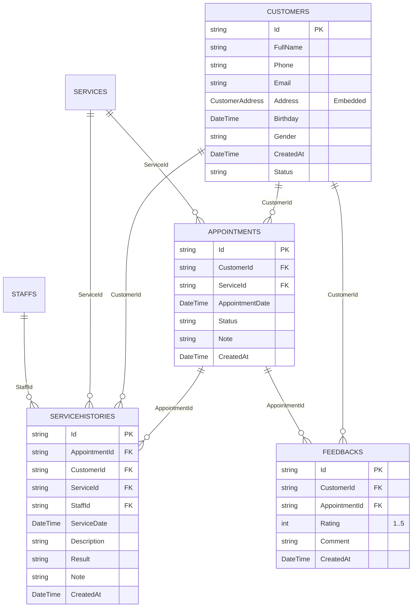

# THIẾT KẾ CƠ SỞ DỮ LIỆU RAVENDB - CUSTOMERCAREDB

## 1. Tổng Quan Cơ Sở Dữ Liệu
- **Tên cơ sở dữ liệu:** `CustomerCareDB`
- **Công nghệ lưu trữ:** RavenDB Document Database (NoSQL) v7.2.6
- **Mục tiêu:** Quản lý hồ sơ khách hàng, phân công nhân viên, danh mục dịch vụ, lịch hẹn, lịch sử thực hiện dịch vụ thực tế và phản hồi đánh giá của trung tâm chăm sóc khách hàng.
- **Tiêu chuẩn thời gian:** Toàn bộ giá trị `DateTime` được chuẩn hóa lưu trữ theo định dạng **UTC** (`DateTime.UtcNow`).

---

## 2. Danh Sách 6 Primary Collections

Hệ thống được thiết kế chuẩn hóa trên 6 Collection tài liệu gốc:
1. `Customers` (Hồ sơ khách hàng)
2. `Staffs` (Hồ sơ nhân viên/kỹ thuật viên)
3. `Services` (Danh mục gói dịch vụ)
4. `Appointments` (Lịch hẹn dịch vụ)
5. `ServiceHistories` (Nhật ký thực hiện dịch vụ thực tế)
6. `Feedbacks` (Đánh giá mức độ hài lòng của khách hàng)

---

## 3. Chi Tiết Lược Đồ Tài Liệu (Document Schemas)

### 3.1. Customers
Đại diện cho thông tin khách hàng đăng ký dịch vụ tại trung tâm.
- **Định dạng ID:** `customers/{id}` (Ví dụ: `customers/001`)
- **Các trường dữ liệu:**
  - `Id`: string (Khóa chính tài liệu)
  - `FullName`: string (Họ và tên khách hàng)
  - `Phone`: string (Số điện thoại liên hệ)
  - `Email`: string (Hộp thư điện tử)
  - `Address`: `CustomerAddress` (**Embedded Document**)
  - `Birthday`: DateTime? (Ngày sinh, nullable)
  - `Gender`: string (Giới tính: "Nam", "Nữ", "Khác")
  - `CreatedAt`: DateTime (Thời điểm tạo bản ghi UTC)
  - `Status`: string (Trạng thái: "Active", "Inactive")

#### Embedded Document: `CustomerAddress`
> [!NOTE]
> `Address` là một **Embedded Document** (Tài liệu nhúng), **KHÔNG PHẢI** một Collection riêng biệt.
- **Các trường con:**
  - `Street`: string (Số nhà, tên đường)
  - `Ward`: string (Phường/Xã)
  - `District`: string (Quận/Huyện)
  - `City`: string (Tỉnh/Thành phố)

**Lý do kiến trúc:**
- Trong mô hình Document Database, địa chỉ thuộc quyền sở hữu 1-1 chặt chẽ với khách hàng.
- Việc nhúng (Embedding) giúp truy vấn hồ sơ khách hàng chỉ tốn **1 lần đọc duy nhất** (O(1)), không cần phép JOIN tốn kém.
- Đảm bảo tính nhất quán và nguyên tử (ACID transaction) khi cập nhật thông tin khách hàng.

---

### 3.2. Staffs
Đại diện cho nhân viên kỹ thuật hoặc điều phối viên chăm sóc khách hàng.
- **Định dạng ID:** `staffs/{id}` (Ví dụ: `staffs/001`)
- **Các trường dữ liệu:**
  - `Id`: string
  - `FullName`: string (Họ tên nhân viên)
  - `Position`: string (Chức vụ/Vị trí kỹ thuật)
  - `Phone`: string (Số điện thoại)
  - `Email`: string (Email công việc)
  - `CreatedAt`: DateTime (Thời điểm tạo UTC)

---

### 3.3. Services
Danh mục các gói dịch vụ bảo dưỡng, sửa chữa hoặc chăm sóc do trung tâm cung cấp.
- **Định dạng ID:** `services/{id}` (Ví dụ: `services/001`)
- **Các trường dữ liệu:**
  - `Id`: string
  - `Name`: string (Tên dịch vụ)
  - `Description`: string (Mô tả chi tiết công việc trong gói)
  - `Price`: decimal (Đơn giá dịch vụ)
  - `Category`: string (Phân loại dịch vụ)
  - `CreatedAt`: DateTime (Thời điểm tạo UTC)

---

### 3.4. Appointments
Quản lý lịch hẹn dịch vụ của khách hàng.
- **Định dạng ID:** `appointments/{id}` (Ví dụ: `appointments/001`)
- **Các trường dữ liệu:**
  - `Id`: string
  - `CustomerId`: string (Tham chiếu ID: `Customers.Id`)
  - `ServiceId`: string (Tham chiếu ID: `Services.Id`)
  - `AppointmentDate`: DateTime (Thời gian hẹn lịch UTC)
  - `Status`: string ("Pending", "Confirmed", "Completed", "Cancelled")
  - `Note`: string (Ghi chú lịch hẹn - **Bắt buộc dùng `Note`, không dùng `Notes`**)
  - `CreatedAt`: DateTime (Thời điểm tạo UTC)

---

### 3.5. ServiceHistories
Nhật ký thực hiện dịch vụ thực tế khi kỹ thuật viên xử lý thiết bị cho khách.
- **Định dạng ID:** `servicehistories/{id}` (Ví dụ: `servicehistories/001`)
- **Các trường dữ liệu:**
  - `Id`: string
  - `AppointmentId`: string (Tham chiếu ID: `Appointments.Id`)
  - `CustomerId`: string (Tham chiếu ID: `Customers.Id`)
  - `ServiceId`: string (Tham chiếu ID: `Services.Id`)
  - `StaffId`: string (Tham chiếu ID: `Staffs.Id`)
  - `ServiceDate`: DateTime (Ngày thực hiện thực tế UTC - **Bắt buộc dùng `ServiceDate`, không dùng `CompletedAt`**)
  - `Description`: string (Nội dung thao tác kỹ thuật)
  - `Result`: string (Kết quả kiểm thử sau dịch vụ)
  - `Note`: string (Ghi chú - **Bắt buộc dùng `Note`, không dùng `Notes`**)
  - `CreatedAt`: DateTime (Thời điểm tạo UTC)

---

### 3.6. Feedbacks
Đánh giá chất lượng và phản hồi từ khách hàng sau khi dịch vụ hoàn thành.
- **Định dạng ID:** `feedbacks/{id}` (Ví dụ: `feedbacks/001`)
- **Các trường dữ liệu:**
  - `Id`: string
  - `CustomerId`: string (Tham chiếu ID: `Customers.Id`)
  - `AppointmentId`: string (Tham chiếu ID: `Appointments.Id` - **Bắt buộc liên kết qua AppointmentId, KHÔNG thay thế bằng ServiceHistoryId**)
  - `Rating`: int (Điểm số hài lòng từ 1 đến 5 sao)
  - `Comment`: string (Nội dung nhận xét)
  - `CreatedAt`: DateTime (Thời điểm đánh giá UTC)

---

## 4. Mô Hình Quan Hệ Tài Liệu (Document Relationships)



---

## 5. Quy Tắc Ràng Buộc Toàn Vẹn (Integrity & Validation Rules)

Trước khi lưu trữ bất kỳ bản ghi phụ thuộc nào, Data Layer bắt buộc phải xác thực thông qua `IDocumentValidator`:
1. **Kiểm tra sự tồn tại tài liệu:** Document được tham chiếu (`CustomerId`, `ServiceId`, `StaffId`, `AppointmentId`) phải tồn tại trong cơ sở dữ liệu.
2. **Tính nhất quán của ServiceHistory:**
   - `ServiceHistory.CustomerId` PHẢI khớp với `Appointment.CustomerId`.
   - `ServiceHistory.ServiceId` PHẢI khớp với `Appointment.ServiceId`.
3. **Tính nhất quán của Feedback:**
   - `Feedback.CustomerId` PHẢI khớp với `Appointment.CustomerId`.
   - `Feedback.Rating` PHẢI nằm trong khoảng từ 1 đến 5 (1 <= Rating <= 5).
4. **Chuẩn hóa thời gian:** Mọi giá trị DateTime phải là UTC trước khi lưu.

---

## 6. Chiến Lược Đánh Chỉ Mục (Indexing Strategy)

### 6.1. Auto-Indexes (Tự động sinh bởi RavenDB)
Khi ứng dụng thực thi truy vấn động với mệnh đề `where`, RavenDB Query Optimizer sẽ tự động sinh các Auto-Index và thăng hạng thành bền vững khi truy vấn lặp lại:
- `Auto/Customers/ByPhone`
- `Auto/Appointments/ByCustomerIdAndStatus`
- `Auto/Feedbacks/ByRating`
- `Auto/ServiceHistories/ByAppointmentIdAndCustomerIdAndServiceDateAndStaffId`

### 6.2. Static Index: `ServiceHistories/ByCustomerAndDate`
Được định nghĩa tường minh bằng C# (`AbstractIndexCreationTask<ServiceHistory>`) và tự động triển khai khi ứng dụng khởi động.
- **Mục đích:** Tối ưu hóa việc lọc lịch sử chăm sóc theo khách hàng và sắp xếp/phạm vi theo thời gian thực hiện.
- **RQL Map Expression:**
```javascript
from history in docs.ServiceHistories
select new
{
    history.CustomerId,
    history.ServiceDate
}
```
